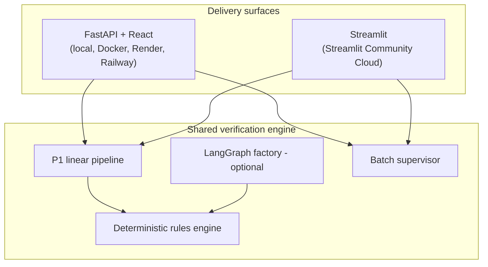

# Approach, tools, and trade-offs

> **Canonical docs:** [README](README.md) · **this file** · [SECURITY_ACCESSIBILITY](SECURITY_ACCESSIBILITY.md) · [PRD](PRD.md) · [ClientRequirement](ClientRequirement.md)
> **Application code:** [`app/`](app/) · **Last verified:** 2026-10-19

This document is the "brief documentation of approach, tools, assumptions, and trade-offs" the client asked for. It is written for both the client reviewer and the technical interviewer: everything below maps to code you can open.

---

## 1. What was asked

[ClientRequirement.md](ClientRequirement.md) asks for a standalone prototype that:

1. accepts a label image plus the corresponding application data;
2. extracts the required TTB fields from the label (brand, class/type, alcohol content, net contents, government warning, bottler/producer address, country of origin for imports);
3. returns fast, field-by-field pass/fail results, including exact government-warning validation;
4. handles batch submissions at **200–300 labels** during peak periods;
5. presents a UI simple enough for a new compliance agent;
6. documents approach, tools, assumptions, and trade-offs.

Exactly **two submissions** are required: the source repository and a deployed URL. Everything else in this repo supports those two.

---

## 2. Architecture

Three delivery surfaces share **one verification engine**. Nothing about the rules, OCR adapters, or batch semantics is reimplemented per surface.



| Layer | Responsibility | Location |
|-------|----------------|----------|
| Ingest | size, MIME, magic-byte and decode validation | [`app/src/ingest/validator.py`](app/src/ingest/validator.py) |
| OCR | Tesseract (default, offline), Azure Document Intelligence (optional), content-addressed fixture sidecar (dev/offline only) | [`app/src/adapters/ocr/`](app/src/adapters/ocr/) |
| Structure | map OCR text/blocks to label fields | [`app/src/structure/field_mapper.py`](app/src/structure/field_mapper.py) |
| Rules | deterministic, per-field verdicts | [`app/src/rules/`](app/src/rules/) |
| Pipeline | orchestrate ingest → OCR → structure → rules, with fallbacks and timing | [`app/src/verify/pipeline.py`](app/src/verify/pipeline.py) |
| Batch | concurrency cap, progress, persistence, resume | [`app/src/verify/batch_service.py`](app/src/verify/batch_service.py) |
| API | `/verify`, `/batch/verify`, `/batch/verify-csv`, `/batch/{id}`, `/batch/{id}/resume`, `/health`, sample/label endpoints, `/docs` | [`app/src/api/main.py`](app/src/api/main.py) |
| Observability | JSON logs, request-scoped `trace_id`, `X-Trace-ID` header | [`app/src/observability.py`](app/src/observability.py) |
| React UI | two-tab workflow, sample gallery, label picker, batch progress, CSV export | [`app/ui/src/App.tsx`](app/ui/src/App.tsx) |
| Streamlit UI | single, chunked/resumable batch, results + CSV | root [`streamlit_app.py`](streamlit_app.py) shim → [`app/streamlit_app.py`](app/streamlit_app.py) |
| Streamlit deps | exact-pinned root/app manifests (CI parity check) | [`requirements.txt`](requirements.txt) · [`app/requirements.txt`](app/requirements.txt) |
| Optional depth | agent factory, LangGraph workflow, RAG grounding, evals | [`app/src/factory/`](app/src/factory/), [`app/src/graph/`](app/src/graph/), [`app/src/rag/`](app/src/rag/), [`app/evals/`](app/evals/) |

**Design rule:** orchestration is pluggable; **deterministic rules own compliance verdicts**. Agents may assist extraction; they never decide pass/fail.

---

## 3. Verification approach

### 3.1 Field-by-field comparison

| Field | Strategy | Why |
|-------|----------|-----|
| **Brand name** | normalized fuzzy match with casing/apostrophe/punctuation tolerance; near matches surface as `needs_review` | Dave Morrison's brand-nuance requirement; avoids both false passes and false failures |
| **Class/type** | normalized exact/contains comparison | stable, low-ambiguity field |
| **Alcohol content** | parse ABV and proof numerically; accept equivalent formats (`45% Alc./Vol.` = `90 Proof`) | labels legitimately vary format |
| **Net contents** | unit-aware comparison (`750 mL` = `750ml`) | common labeling variation |
| **Government warning** | exact word-for-word canonical text; header must be all-caps and bold (pixel ink-density heuristic) | Jenny Park's requirement; legal text cannot be approximated |
| **Bottler/producer address** | normalized containment check | label artwork often abbreviates |
| **Country of origin** | normalized exact check when the application declares an import | required for imports only |

Each field returns one of four statuses with the application value, label value, and a human-readable reason: `match`, `mismatch`, `needs_review`, `unable_to_verify`. The label summary is `failed` if any field mismatches, `needs_review` if any field cannot be verified, otherwise `passed`.

**No auto-approval.** A `passed` result means "no discrepancy detected by these rules," not legal approval. Human agents remain authoritative.

### 3.2 OCR strategy

- **Tesseract is the default** and runs offline — no firewall dependency for the core demo.
- **Azure Document Intelligence** is optional (`OCR_PROVIDER=azure` plus credentials) and falls back to Tesseract.
- **Fixture sidecar** text is used only during development/offline evals when Tesseract is unavailable. It is **content-addressed**: the submitted bytes must match the committed fixture PNG exactly, otherwise no text is returned. A client-supplied `label_id` can never fabricate a verdict. Stems are validated with the shared label-id validator (no path traversal).
- OCR failures degrade to `unable_to_verify`; they never crash a request.

### 3.3 Evals

- **30 golden fixtures** run in CI as a regression gate ([`app/evals/runners/run_eval_suite.py`](app/evals/runners/run_eval_suite.py)).
- The suite reports summary accuracy, per-field accuracy, warning recall, false-pass rate, RAG hit rate, and latency P95.
- **63 pytest tests** cover rules, batch semantics, eval metrics, OCR adapters, logging, and API behavior; deterministic rules hold **100%** statement coverage with an 80% CI gate.
- Current results: **100%** golden summary accuracy, **100%** adversarial warning recall, **0%** false-pass rate on the adversarial set. Local golden-path P95 is milliseconds with the sidecar; the deployed streaming path targets **≤ ~5 s per label**.

---

## 4. Batch approach (200–300 labels)

| Concern | Decision |
|---------|----------|
| **API/Docker** | `POST /batch/verify` (JSON manifest) or `/batch/verify-csv`; concurrency capped by `BATCH_CONCURRENCY` (default 6); progress persisted when `BATCH_PERSIST=true`; HITL resume via `POST /batch/{id}/resume` |
| **Streamlit** | runs the same pipeline in **chunks of 25** with concurrency **4**, checkpointing to `st.session_state` after every chunk |
| **Why chunking on Streamlit** | the free Community Cloud tier has limited memory/CPU and a single long request is fragile; chunking bounds memory, keeps the UI responsive, and makes a 300-label run **resumable** rather than capped |
| **Failure isolation** | one unreadable label records an error for that label only; the batch continues |
| **Progress** | per-label elapsed time, mean latency, count above the 5 s budget, CSV export of every result |
| **Idempotent resume** | resume skips already-completed labels; uploaded image bytes are released after their chunk completes |

Nothing is truncated or silently dropped at 200 or 300 labels. A completed 300-label Streamlit batch was verified end-to-end headlessly, including a simulated interruption at label 50 followed by a successful resume.

---

## 5. AI-native engineering depth (optional, behind flags)

The client only requires the P1 path. The repository also demonstrates deliberately bounded AI-native depth:

| Capability | Flag | Notes |
|------------|------|-------|
| Agent factory + LangGraph | `USE_FACTORY_GRAPH=true` | same verdict outcomes as P1; graph owns orchestration only |
| RAG grounding over TTB corpus | `RAG_ENABLED=true` | retrieval informs extraction/nuance; rules own verdicts |
| Eval harness | always available / CI gate | 30 golden + adversarial + RAG queries |
| Azure OCR | `OCR_PROVIDER=azure` | optional; Tesseract fallback |

If a reviewer disables every flag, the app still satisfies the client brief.

---

## 6. Tools and versions

### Runtime

| Component | Version | Notes |
|-----------|---------|-------|
| Python | 3.11+ (CI: 3.11) | matches deploy targets |
| FastAPI | 0.150.0 | API |
| Starlette | 1.9.0 | via FastAPI; pinned floor |
| Uvicorn | 0.54.0 | ASGI server |
| Pydantic / pydantic-settings | 2.14 / 2.16 | models + env config |
| Pillow | **13.0.0** (API/Docker) · **12.3.0** (Streamlit) | see §7.2 |
| pytesseract | 0.3.13 | Tesseract adapter |
| LangGraph / langchain-core | 1.2.16 / 1.6.12 | optional depth |
| Streamlit | 1.66.0 | Community Cloud surface |
| React / TypeScript / Vite | 18.3 / 5.x / 5.4 | UI |
| Node.js | 24 (CI + Docker) | Node 20 is EOL |
| Tesseract | 5.x in CI/Docker · 4.1.1 on Streamlit Cloud (Debian bullseye) | see §7.3 |

### Engineering

| Tool | Purpose |
|------|---------|
| pytest / pytest-asyncio / pytest-cov | unit + async tests |
| ruff | lint gate |
| pip-audit | Python dependency advisories from the hash-pinned lockfile |
| npm audit | production npm advisories |
| gitleaks | secret scan in CI |
| Dependabot | weekly pip / npm / Actions updates |
| uv | hash-pinned `requirements.lock` for the API/Docker surface |
| GitHub Actions | six jobs: `test`, `ui`, `lint-and-security`, `locked-install`, `streamlit-smoke`, `docker` |

---

## 7. Upgrade register

### 7.1 Applied in the 2026-10-19 audit

| Package | From | To | Reason |
|---------|------|----|--------|
| Pillow | 11.x / 12.2 | **13.0.0** | image-decode security fixes (API/Docker) |
| FastAPI | 0.115 | 0.150.0 | current minor; Starlette 1.x |
| Starlette | 0.46 | 1.9.0 | current; explicit floor |
| Uvicorn | 0.34 | 0.54.0 | current |
| Pydantic / pydantic-settings | 2.13 / 2.6 | 2.14 / 2.16 | current |
| LangGraph / langchain-core | 1.2.4 / 1.4.3 | 1.2.16 / 1.6.12 | current |
| pytest / pytest-asyncio / ruff | 8.x / 0.24 / 0.11 | 9.1.1 / 1.4 / 0.17.1 | current; coverage plugin added |
| Node.js | 20 | **24** | Node 20 EOL |
| GitHub Actions | checkout@v4, setup-*@v4/v5, upload-artifact@v4 | @v7 | current majors |
| npm install | — | **npm ci** | reproducible installs |
| Pillow API | `getdata()` | `get_flattened_data()` with fallback | removed in Pillow 14 |

### 7.2 Deferred: Vite 8 major (dev-only)

`npm audit` still reports advisories in **dev-only** `esbuild`/`vite` (development server). Resolving them requires Vite 8, a major upgrade with breaking config changes. The production UI is a static build served by FastAPI; the vulnerable dev server is never deployed. **Deferred with Dependabot tracking**; revisit when Vite 8 adoption is routine.

### 7.3 Constraint: Streamlit pins `pillow<13`

Streamlit 1.66 requires `pillow<13`. The Streamlit surface therefore pins **Pillow 12.3.0** — the patched 12.x line with **zero** known OSV advisories — while the API/Docker surface uses 13.0.0. The Streamlit upload path additionally enforces a strict raster-format allowlist, a 40 MP decode ceiling, and full decode verification. Revisit when Streamlit relaxes the pin.

### 7.4 Deferred / accepted

| Item | Status |
|------|--------|
| Python 3.11 baseline | accepted; all deploy targets support it |
| Optional Azure SDK / Chroma extras | optional, not on the P1 path; lockfile covers resolved versions |
| `STRICT_WARNING` setting | reserved/unused; warning validation is always strict (documented, no behavior change) |
| Vite 8 | deferred (§7.2) |
| Hash-pinned lockfile for Streamlit | not possible on Community Cloud; root `requirements.txt` and `app/requirements.txt` are exact-pinned, with CI enforcing parity |

---

## 8. Assumptions

1. Application data is supplied alongside each label; there is **no COLA integration**.
2. Prototype data is synthetic/non-sensitive; no PII, no CUI.
3. Government warning canonical text is fixed and seeded in rules/fixtures.
4. Bold detection uses image heuristics, not font metadata; behavior is documented and tested.
5. A human agent remains the final authority; the tool never auto-approves.
6. Evaluators can reach a public HTTPS URL (the submission still needs the Render service resumed or the Streamlit app published); cloud OCR is optional and off by default.
7. Batch manifests are JSON (`/batch/verify`) or CSV (`/batch/verify-csv`); images are matched to application records by `label_id`.

---

## 9. Trade-offs and limitations

| Trade-off | Decision | Consequence |
|-----------|----------|-------------|
| **No auth on the public demo** | deliberate prototype posture (PRD §8) | anyone can use the demo; no sensitive data is accepted; documented in [SECURITY_ACCESSIBILITY.md](SECURITY_ACCESSIBILITY.md) |
| **Deterministic rules over LLM verdicts** | auditability and reproducibility | less flexible on exotic label layouts |
| **Tesseract default** | offline/firewall-safe | lower accuracy on glare/skew than a paid OCR API; pre-processing flag available |
| **Streamlit chunk size 25 / concurrency 4** | bounded memory on free tier | slightly lower throughput than the containerized API (6 concurrent) |
| **Session-scoped Streamlit checkpoints** | no server-side storage | resume works across reruns in the same session; a hard browser reload starts fresh |
| **In-memory batch state by default** | simplicity | enable `BATCH_PERSIST=true` for file-backed progress |
| **Pillow split (13 vs 12.3)** | Streamlit compatibility | two patched lines to track (§7.3) |
| **Tesseract 4.1.1 on Community Cloud** | platform image | OCR may differ slightly from CI/Docker 5.x; golden evals run in CI, and the gallery/scale batches must be smoke-tested after publish |
| **Archived docs** | repository consolidation | [`docs/archive/`](docs/archive/) retains history; live docs are the five at root |

### Deliberately cut (with rationale)

Per PRD §5.2 these are **out of scope** and are not partial implementations:

- document retention/purge policy and data-classification program;
- CUI/PIA documentation;
- NIST 800-53 / CISA attestation;
- VPAT;
- production identity/SSO, WAF/rate limiting, managed queue/object storage, database-backed audit trail.

The production-hardening backlog is listed in [SECURITY_ACCESSIBILITY.md](SECURITY_ACCESSIBILITY.md) §6.

---

## 10. How to verify this yourself

From `app/`:

```bash
pytest tests/ -q                              # 63 tests
pytest tests/ -q --cov=src.rules --cov-fail-under=80   # rules coverage gate
python evals/runners/run_eval_suite.py        # 30 golden fixtures
ruff check src tests                          # lint
USE_FACTORY_GRAPH=true pytest tests/ -q       # graph parity smoke
RAG_ENABLED=true pytest tests/ -q             # RAG smoke
```

UI and containers:

```bash
cd ui && npm ci && npm run build              # static production build
docker compose up --build                     # http://localhost:8000
```

Streamlit:

```bash
pip install -r requirements.txt
streamlit run streamlit_app.py
```

The app-directory form still works: `pip install -r app/requirements.txt && streamlit run app/streamlit_app.py`.

Deployment instructions for all five runtime targets (plus CI) are in [README.md](README.md#deployment-options).

---

## 11. Repository map

```
.
├── README.md                     # setup/run, all deployment options, reviewer path
├── APPROACH.md                   # this document
├── SECURITY_ACCESSIBILITY.md     # prototype posture, 508 fixes, hardening backlog
├── PRD.md                        # requirements + phased delivery
├── ClientRequirement.md          # normative client brief (verbatim)
├── CONTRIBUTING.md / SECURITY.md # contribution + disclosure
├── streamlit_app.py              # Community Cloud root entrypoint (shim)
├── requirements.txt              # Streamlit-only pinned deps (root deploy)
├── app/                          # runnable application
│   ├── streamlit_app.py          # Streamlit implementation (same engine)
│   ├── requirements.txt          # Streamlit-only pinned deps (app entrypoint)
│   ├── pyproject.toml            # API/Docker deps
│   ├── Dockerfile / docker-compose.yml / railway.toml / DEPLOY.md
│   ├── src/                      # engine, API, adapters, rules, optional depth
│   ├── ui/                       # React + TypeScript
│   ├── fixtures/                 # synthetic labels + applications
│   ├── evals/                    # golden + adversarial + RAG eval suites
│   └── tests/                    # 63 pytest tests
├── packages.txt                  # Streamlit Cloud apt packages (tesseract)
├── .streamlit/config.toml        # Streamlit theme/config
├── requirements.lock             # hash-pinned Python lock (API/Docker)
├── render.yaml                   # Render Blueprint
├── .github/workflows/ci.yml      # six CI jobs
└── docs/archive/                 # historical docs (superseded)
```
