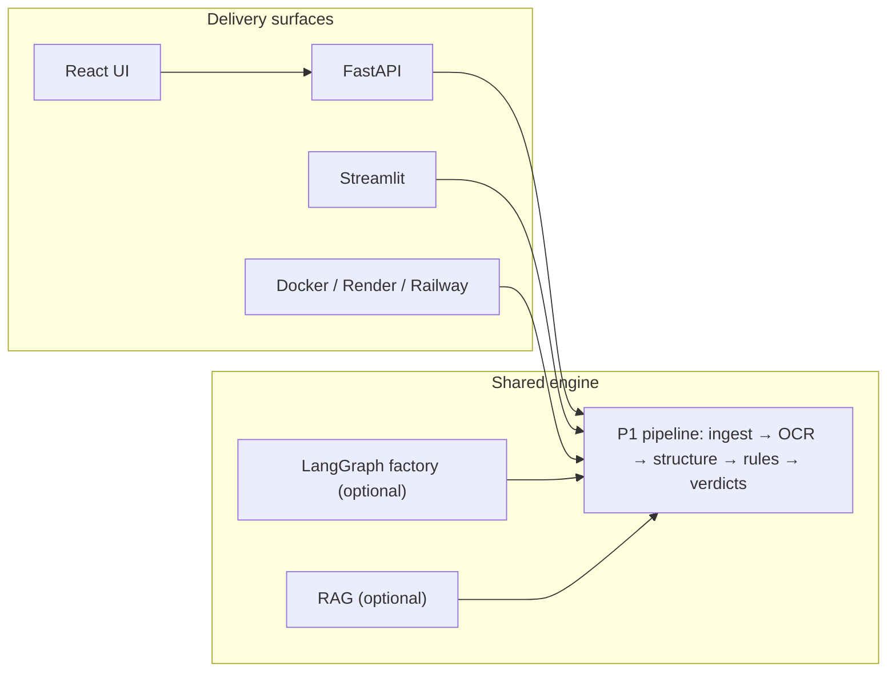
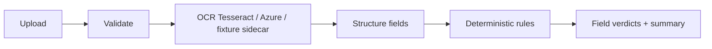

# LabelForge — TTB Alcohol Label Verification

[CI](https://github.com/monigarr/instructions/actions/workflows/ci.yml) · [Approach](APPROACH.md) · [Security & accessibility](SECURITY_ACCESSIBILITY.md) · [PRD](PRD.md)

**AI-assisted alcohol label verification** for the TTB Compliance Division: upload a label image and its application data, get fast field-by-field results — including exact government-warning validation — with a human always in charge.

> **Take-home submission.** Runnable code lives in [`app/`](app/). [**ClientRequirement.md**](ClientRequirement.md) is the normative client brief; every other document derives from it.
>
> **Two required deliverables**
> 1. **Source repository** — [github.com/monigarr/instructions](https://github.com/monigarr/instructions)
> 2. **Deployed application URL** — **Live:** [labelforge-monigarr.streamlit.app](https://labelforge-monigarr.streamlit.app/) (Streamlit Community Cloud, public, no login). The full FastAPI + React stack is also configured on Render at [labelforge-w32d.onrender.com](https://labelforge-w32d.onrender.com), but that service is currently **suspended** in Render (`503`, `x-render-routing: suspend`). The Streamlit deploy entrypoint is the repo-root [`streamlit_app.py`](streamlit_app.py), a thin shim over [`app/streamlit_app.py`](app/streamlit_app.py). Steps for both targets are in [Deployment options](#deployment-options).

**Prototype posture:** synthetic fixtures only, no COLA integration, no authentication on the public demo, no sensitive data. See [SECURITY_ACCESSIBILITY.md](SECURITY_ACCESSIBILITY.md).

---

## What it does

- **Single-label verification:** upload a label + application JSON (or pick a curated sample) → OCR → structured fields → deterministic rules → per-field `match` / `mismatch` / `needs_review` / `unable_to_verify` with reasons.
- **Batch verification:** 200–300 labels via JSON manifest or CSV manifest (API), or built-in 200/300 fixture batches (Streamlit) with chunked, resumable progress and CSV export.
- **TTB field coverage:** brand name, class/type, alcohol content (ABV/proof), net contents, government warning (exact text + all-caps bold header), bottler/producer address, country of origin for imports.
- **Human authority:** the tool never auto-approves a COLA; `passed` means "no discrepancy detected by these rules."
- **Three surfaces, one engine:** FastAPI + React, Streamlit, and a Docker image all call the same pipeline, rules, and adapters.

### Architecture at a glance



**Principle:** orchestration is pluggable; **deterministic rules own compliance verdicts**.



---

## Canonical inventory

Verified against the repo on **2026-10-19**. Use these counts consistently.

| Term | Count | Source |
|------|-------|--------|
| **Golden eval set** | **30** | [`app/evals/datasets/golden_labels.jsonl`](app/evals/datasets/golden_labels.jsonl) — CI regression gate |
| **Full synthetic catalog** | **34** | [`fixture_catalog()`](app/scripts/generate_fixtures.py), [`batch_manifest.json`](app/fixtures/applications/batch_manifest.json) |
| **Scale test fixtures** | **300** | `scale_001`…`scale_300` — [`generate_scale_fixtures.py`](app/scripts/generate_scale_fixtures.py), [`batch_manifest_200.json`](app/fixtures/applications/batch_manifest_200.json) / [`_300`](app/fixtures/applications/batch_manifest_300.json) |
| **Curated gallery samples** | **10** | [`SAMPLE_CATALOG`](app/src/api/samples_catalog.py) — one-click demo cards |
| **Non-golden stretch fixtures** | **4** | `warning_not_bold`, `label_slight_rotation`, `label_low_contrast`, `label_glare_band` — in gallery/catalog, excluded from golden CI (visual variance) |
| **Pytest unit tests** | **65** | `pytest tests/` (rules coverage 100%) |
| **CI jobs** | **6** | `.github/workflows/ci.yml`: `test`, `ui`, `lint-and-security`, `locked-install`, `streamlit-smoke`, `docker` |
| **Runtime deployment targets** | **5** | Streamlit Community Cloud · Render · Railway · Docker Compose · local uvicorn + Vite (plus GitHub Actions CI, which does not deploy) |
| **Extra label PNGs** | varies | Label picker only (synthetic fictional-brand labels, e.g. `DonPapa.png`); not in catalog or scale manifests |

---

## Who is reviewing?

### Client reviewers ([ClientRequirement.md](ClientRequirement.md))

| Step | What to do | What it proves |
|------|------------|----------------|
| **1. Try the product** | Open [labelforge-monigarr.streamlit.app](https://labelforge-monigarr.streamlit.app/) → **Verify one label** → **Old Tom — Pass** → **Verify label**; or run the local quick start | Deployed URL works; core path is live |
| **2. Spot-check batch** | **Batch verify** → **built-in 200** / **300** quick-start | Peak-load flow (200–300 labels) |
| **3. Check the full stack (optional)** | Run the FastAPI + React quick start locally, or resume the suspended Render service | The same engine behind the production UI |
| **4. Read the approach** | [APPROACH.md](APPROACH.md) | Tools, assumptions, trade-offs, limitations, upgrade register |

**Production Render settings:** `USE_FACTORY_GRAPH=false`, `RAG_ENABLED=false`, `BATCH_PERSIST=true`, `LATENCY_GATE_ENABLED=true`, `OCR_PROVIDER=tesseract`.

| # | Client deliverable | Proof |
|---|-------------------|-------|
| 1 | Source code repository | [`app/`](app/) + [`app/README.md`](app/README.md) |
| 2 | Deployed application URL | **Live:** [labelforge-monigarr.streamlit.app](https://labelforge-monigarr.streamlit.app/) (public Streamlit Community Cloud app) · Render: [labelforge-w32d.onrender.com](https://labelforge-w32d.onrender.com) (configured; currently suspended) |

### Client requirement coverage

[`ClientRequirement.md`](ClientRequirement.md) is the upstream client brief verbatim. This table maps each required/evaluated item to the implementation and a proof path.

| Client requirement | Implementation | Proof |
|--------------------|----------------|-------|
| Source repository, README with setup/run | This README, [`app/README.md`](app/README.md), [`app/DEPLOY.md`](app/DEPLOY.md) | [Quick start](#quick-start-local) · [Deployment options](#deployment-options) |
| Brief approach, tools, assumptions, trade-offs | [`APPROACH.md`](APPROACH.md) | §1–§9 |
| Deployed application URL | Live Streamlit app + Render blueprint | [labelforge-monigarr.streamlit.app](https://labelforge-monigarr.streamlit.app/) · [`render.yaml`](render.yaml) · [`streamlit_app.py`](streamlit_app.py) |
| Upload label image + application data | React UI, Streamlit, API | [`app/ui/src/App.tsx`](app/ui/src/App.tsx) · [`app/streamlit_app.py`](app/streamlit_app.py) · [`app/src/api/main.py`](app/src/api/main.py) |
| Extract required TTB fields | OCR + structure mapper | [`app/src/structure/field_mapper.py`](app/src/structure/field_mapper.py) |
| Field-by-field pass/fail, exact warning | Deterministic rules + pixel bold-header check | [`app/src/rules/`](app/src/rules/) |
| Batch 200–300 at peak | API manifests + chunked Streamlit batch | `/batch/verify`, `/batch/verify-csv`, built-in 200/300 quick-starts |
| Simple UI for a new agent | Two-task workflow, sample gallery, plain-language results | React UI + Streamlit surface |
| ≤ ~5 s per label | Latency budget + flagging; measured container path ~3.7 s before suspension | `elapsed_ms`, `LATENCY_WARN_MS`; local golden P95 is milliseconds with the sidecar |
| Imperfect images (stretch) | Optional preprocessing flag; visual-variance fixtures | `PREPROCESS_IMPERFECT=true`; four non-golden fixtures in the gallery |
| No COLA integration, offline OCR, no sensitive storage | Tesseract default; synthetic fixtures; session-scoped results | [`APPROACH.md](APPROACH.md) §3.2, [SECURITY_ACCESSIBILITY.md](SECURITY_ACCESSIBILITY.md) |

### Stakeholder traceability

| Stakeholder | Requirement | Implementation |
|-------------|-------------|----------------|
| **Sarah Chen** | ≤ ~5 s per label; batch 200–300 | `elapsed_ms` in API/UI; batch quick-starts; chunked Streamlit batch; latency warning over budget |
| **Jenny Park** | Government warning exactness | `WarningExactRule` + pixel bold-header analysis; `warning_title_case`, `warning_wording_change` fixtures |
| **Dave Morrison** | Brand nuance; simple workflow | Fuzzy brand rule with casing/apostrophe tolerance → `needs_review`; two-tab UI |
| **Marcus Williams** | Standalone, offline OCR, no COLA, sensible security | Tesseract default; synthetic fixtures; no COLA; hardened uploads, CORS, headers, non-root container |

### Technical interviewers (engineering depth)

Everything below is optional and toggleable; P1 verdicts are unchanged.

| Layer | Entry point | Flag |
|-------|-------------|------|
| **Eval harness** (30 golden + adversarial + RAG) | [`app/evals/runners/run_eval_suite.py`](app/evals/runners/run_eval_suite.py) | CI gate |
| **Agent factory + LangGraph** | [`app/src/factory/`](app/src/factory/), [`app/src/graph/`](app/src/graph/) | `USE_FACTORY_GRAPH=true` |
| **RAG grounding** | [`app/src/rag/`](app/src/rag/), [`app/src/agents/compliance_rag_agent.py`](app/src/agents/compliance_rag_agent.py) | `RAG_ENABLED=true` |
| **Design history** | [`docs/archive/ARCHITECTURE.md`](docs/archive/ARCHITECTURE.md) | archived |
| **Decision record** | [APPROACH.md](APPROACH.md) §5–§9 | — |

---

## Quick start (local)

### A. Full app — FastAPI + React

```bash
cd app
python -m venv .venv
# Windows: .venv\Scripts\activate
# macOS/Linux: source .venv/bin/activate
pip install -e ".[dev]"
cp .env.example .env
python scripts/generate_fixtures.py
python scripts/generate_scale_fixtures.py
python scripts/generate_eval_datasets.py
uvicorn src.api.main:app --reload --port 8000
```

In a second terminal:

```bash
cd app/ui
npm ci
npm run dev        # http://localhost:5173
```

For Vite dev, create `app/ui/.env.local` with `VITE_API_URL=http://localhost:8000` so the gallery and label picker reach the API.

API docs: <http://localhost:8000/docs> · Health: <http://localhost:8000/health>

> Tesseract must be installed for OCR of arbitrary uploads. Without it, the fixture sidecar works only for the committed fixture images (exact content match) — enough to explore the demo. Docker images include Tesseract.

### B. Streamlit surface

```bash
pip install -r requirements.txt
streamlit run streamlit_app.py
```

Opens on <http://localhost:8501>. The app-directory form remains supported for local runs: `pip install -r app/requirements.txt && streamlit run app/streamlit_app.py`.

### C. Docker Compose (API + built UI on one port)

```bash
cd app
docker compose up --build
```

Open <http://localhost:8000>. Tesseract is baked into the image; fixtures and scale manifests are generated at build time.

---

## Deployment options

Five runtime targets are supported, plus CI; none removes or replaces the others. **Streamlit is live** at [labelforge-monigarr.streamlit.app](https://labelforge-monigarr.streamlit.app/); Render is configured but currently suspended.

| # | Target | How | Notes |
|---|--------|-----|-------|
| 1 | **Streamlit Community Cloud** *(`streamlit.io`)* | repo root `streamlit_app.py`; deps `requirements.txt`; apt `packages.txt` | **live** at [labelforge-monigarr.streamlit.app](https://labelforge-monigarr.streamlit.app/); free tier, chunked/resumable batch |
| 2 | **Render** | Blueprint [`render.yaml`](render.yaml) | configured; service currently suspended — resume in dashboard |
| 3 | **Railway** | [`app/railway.toml`](app/railway.toml) + Dockerfile | set root directory to `app` |
| 4 | **Docker / Compose** | [`app/docker-compose.yml`](app/docker-compose.yml) | non-root, healthcheck, one port |
| 5 | **Local** | uvicorn + Vite (above) | development |
| 6 | **CI verification** | [`.github/workflows/ci.yml`](.github/workflows/ci.yml) | six jobs; verifies, does not deploy |

### 1. Streamlit Community Cloud (live deploy target)

**Status:** published and public at [labelforge-monigarr.streamlit.app](https://labelforge-monigarr.streamlit.app/). It redeploys automatically when `main` changes. The steps below reproduce the deployment.

1. Sign in at <https://share.streamlit.io> with GitHub.
2. **Create app** → **Deploy from GitHub**.
3. Repository: `monigarr/instructions` · Branch: `main`.
4. **Main file path:** `streamlit_app.py` (repo root — this is the deploy form's default and executes [`app/streamlit_app.py`](app/streamlit_app.py) through a shim).
5. **Advanced settings** → Python version **3.11** (3.12 also works).
6. Leave secrets empty — the demo needs no credentials.
7. Click **Deploy**. Community Cloud installs root [`requirements.txt`](requirements.txt) (Streamlit-only exact pins), apt packages from root [`packages.txt`](packages.txt) (`tesseract-ocr`), and reads root [`.streamlit/config.toml`](.streamlit/config.toml).
8. Use the assigned `https://<app>.streamlit.app` URL in the submission. The current live URL is [labelforge-monigarr.streamlit.app](https://labelforge-monigarr.streamlit.app/).

If your deploy form allows a subdirectory entrypoint, `app/streamlit_app.py` also works and resolves `app/requirements.txt`.

**Important constraints** (already handled in the repo):

- Root [`requirements.txt`](requirements.txt) and [`app/requirements.txt`](app/requirements.txt) hold the same Streamlit-only pins; CI fails if they drift. Keep both so either entrypoint works.
- [`app/pyproject.toml`](app/pyproject.toml) is the API/Docker project and is safe to keep: Community Cloud checks `requirements.txt` before `pyproject.toml` in the entrypoint directory. Do **not** add `uv.lock`, `Pipfile`, or `environment.yml` at the repo root or in `app/` — those outrank `requirements.txt` and would shadow the Streamlit pins.
- Community Cloud runs Debian bullseye, i.e. **Tesseract 4.1.1** (CI/Docker use 5.x). After deploy, smoke-test the 10-sample gallery and the built-in 300-label batch; OCR is deterministic but version-sensitive.
- Free-tier apps sleep when idle; the first request after sleep is slow. Batch runs are chunked at 25 with concurrency 2 and checkpoint per chunk, so a 200–300 label run resumes instead of failing. The free tier has 1 GB of memory, so run one batch at a time; Python/glibc memory is released after each chunk.

### 2. Render (Blueprint)

1. Log in at <https://render.com> → **New** → **Blueprint**.
2. Connect `monigarr/instructions` and review the generated `labelforge` service (Docker, root dir `app`, Starter plan, health check `/health`).
3. **Apply**. The Blueprint sets `OCR_PROVIDER=tesseract`, `USE_FACTORY_GRAPH=false`, `RAG_ENABLED=false`, `BATCH_PERSIST=true`, `BATCH_CONCURRENCY=6`, `LATENCY_GATE_ENABLED=true`.
4. Render injects `PORT`; the Dockerfile listens on `${PORT:-8000}`.

Manual dashboard option and full settings: [`app/DEPLOY.md`](app/DEPLOY.md).

### 3. Railway

1. Create a project from this repo; set **root directory** to `app`.
2. Railway uses [`app/railway.toml`](app/railway.toml) (Dockerfile builder, health check `/health`).
3. Add the environment variables below; Railway injects `PORT`.
4. Copy the generated HTTPS URL into the submission.

### 4. Docker

```bash
cd app
docker build -t labelforge .
docker run --rm -p 8000:8000 -e BATCH_PERSIST=true labelforge
```

The image runs as **non-root** (`appuser`, uid 10001), writes batch state only under `/app/data`, and exposes a `HEALTHCHECK` against `/health`.

### 5–6. Local and CI

See [Quick start](#quick-start-local) and the [quality gates](#quality-gates). CI runs on every push and PR; it verifies and does not deploy.

---

## Configuration

Copy [`app/.env.example`](app/.env.example) to `app/.env`. Defaults are safe for the demo.

| Variable | Default | Purpose |
|----------|---------|---------|
| `OCR_PROVIDER` | `tesseract` | `tesseract`, or `azure` with credentials |
| `AZURE_DOCUMENT_INTELLIGENCE_ENDPOINT` / `_KEY` | empty | optional cloud OCR |
| `OCR_CONFIDENCE_THRESHOLD` | `0.55` | below this, OCR text is rejected |
| `OCR_TIMEOUT_SECONDS` | `4.0` | per-provider timeout |
| `MAX_UPLOAD_BYTES` | `10485760` | 10 MB per image |
| `MAX_REQUEST_BYTES` | `268435456` | 256 MB per request |
| `MAX_BATCH_FILES` | `400` | files per batch request |
| `MAX_BATCH_MANIFEST_BYTES` | `2097152` | 2 MB manifest |
| `BATCH_CONCURRENCY` | `6` | API batch concurrency |
| `BATCH_PERSIST` | `false` | file-backed batch progress |
| `BATCH_PERSIST_DIR` | `./data/batches` | persisted progress location |
| `LATENCY_WARN_MS` / `LATENCY_GATE_ENABLED` | `5000` / `false` | latency flagging |
| `PREPROCESS_IMPERFECT` | `false` | extra preprocessing for glare/skew |
| `USE_FACTORY_GRAPH` | `false` | LangGraph orchestration |
| `RAG_ENABLED` | `false` | retrieval grounding |
| `CORS_ORIGINS` | `http://localhost:5173,http://localhost:3000` | allowed browser origins |
| `LOG_LEVEL` / `LOG_JSON` | `INFO` / `true` | structured JSON logs with `trace_id`; set `LOG_JSON=false` for plain text |
| `STRICT_WARNING` | `true` | reserved; warning validation is always strict |

Every API response carries an `X-Trace-ID` header (inbound safe IDs are preserved); the same id appears in verification results and JSON logs for correlation.

Streamlit uses platform environment variables only; the demo needs none.

---

## Quality gates

Run from `app/`:

```bash
pytest tests/ -q                              # 65 tests
pytest tests/ -q --cov=src.rules --cov-fail-under=80   # rules coverage gate
python evals/runners/run_eval_suite.py        # 30 golden fixtures
ruff check src tests                          # lint
USE_FACTORY_GRAPH=true pytest tests/ -q       # graph parity
RAG_ENABLED=true pytest tests/ -q             # RAG smoke
python evals/runners/run_latency_benchmark.py # latency report
cd ui && npm ci && npm run build              # type-check + production build
```

CI (`.github/workflows/ci.yml`) enforces:

| Job | Checks |
|-----|--------|
| `test` | fixtures + 65 tests + rules coverage gate + eval suite + latency benchmark |
| `ui` | `npm ci`, production build, `npm audit --omit=dev` |
| `lint-and-security` | `ruff`, `pip-audit -r requirements.lock`, `gitleaks` |
| `locked-install` | install from hash-pinned lockfile, tests + evals |
| `streamlit-smoke` | headless AppTest: root shim + app entrypoint single verify, full 200-label chunked batch, root/app pin parity |
| `docker` | image build, container health check |

Current eval results: **100%** golden summary accuracy, **100%** adversarial warning recall, **0%** false-pass rate.

---

## Security and accessibility

- Prototype, **no auth** on the public demo, synthetic data only; no COLA integration.
- Upload hardening (format allowlist, 40 MP cap, full decode), CORS allowlist without credentials, CSP and security headers, generic 500s with `trace_id`, non-root container, hash-pinned lockfile, `pip-audit`/`npm audit`/`gitleaks`, Dependabot.
- Fixture sidecar OCR is **content-addressed**: it cannot fabricate text for an arbitrary upload.
- Structured JSON logs with `trace_id` propagation (`X-Trace-ID` response header); no image or OCR text is logged.
- Section 508 work: focusable file inputs, ARIA tab semantics with arrow-key navigation, AA contrast (success 6.84:1, warning 6.78:1), no third-party font CDN.

Full posture, known gaps, and the production-hardening backlog: [SECURITY_ACCESSIBILITY.md](SECURITY_ACCESSIBILITY.md). Vulnerability disclosure: [SECURITY.md](SECURITY.md).

---

## Documentation map

| Document | Audience | Purpose |
|----------|----------|---------|
| **[README.md](README.md)** | Everyone | Setup, run, all deployment options, reviewer paths |
| **[APPROACH.md](APPROACH.md)** | Client + interview | Approach, tools, assumptions, trade-offs, upgrade register, deferred items |
| **[SECURITY_ACCESSIBILITY.md](SECURITY_ACCESSIBILITY.md)** | IT + accessibility reviewers | Prototype threat model, controls, 508 fixes, gaps, hardening backlog |
| **[PRD.md](PRD.md)** | Product | Requirements, scope boundary, phases, acceptance criteria |
| **[ClientRequirement.md](ClientRequirement.md)** | Normative | Authoritative client brief (verbatim) |
| [app/README.md](app/README.md) · [app/DEPLOY.md](app/DEPLOY.md) | Developers / ops | App-level runbook and deployment detail |
| [docs/archive/](docs/archive/) | History | Superseded design/proof/review docs (banners explain status) |
| [CONTRIBUTING.md](CONTRIBUTING.md) · [SECURITY.md](SECURITY.md) | Contributors | Workflow, quality gates, disclosure |

---

## Design & UI

The UI follows the [U.S. Web Design System (USWDS 3.0)](https://designsystem.digital.gov/): federal color tokens, button-group tabs, alert patterns, and focus styles in custom CSS ([`app/ui/src/styles.css`](app/ui/src/styles.css)). Fonts use the system stack (no third-party font CDN). The Streamlit surface mirrors the same palette and two-task workflow.

---

## Author

Monica Peters (MoniGarr) — Gauntlet AI GFA Cohort 5 Fellowship, 2026.

Licensed under [Apache-2.0](LICENSE).
